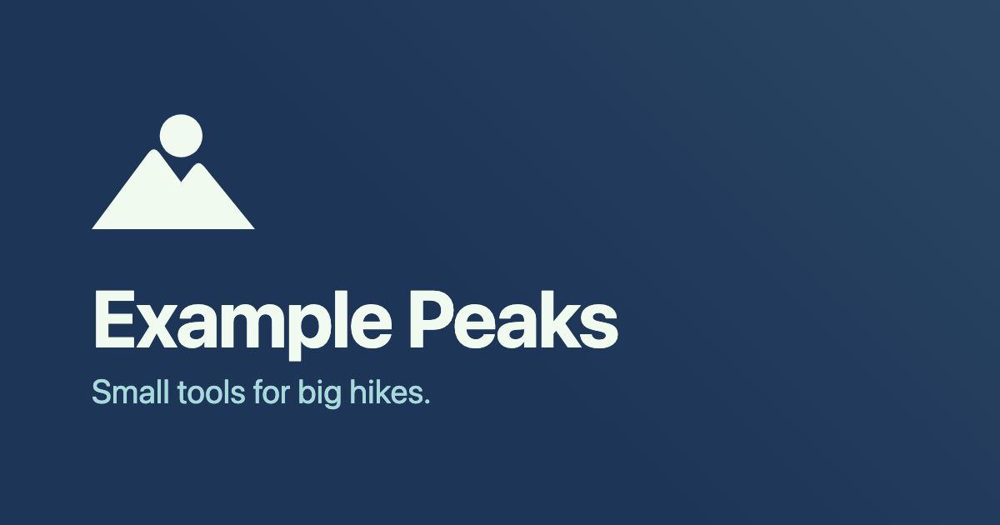

# web-brand-assets

`web-brand-assets` turns a website's logo files into the images and metadata
browsers, phones and link previews look for: favicons, the Apple touch icon,
web app manifest icons (including a maskable one), `site.webmanifest`, and a
1200×630 share image for Open Graph and X/Twitter cards. It also prints the
`<head>` tags that go with them.



It is a Node.js command line tool with no runtime dependencies. The images are
rendered by the headless Chrome you already have installed, so SVG logos stay
sharp at every size and the share image gets real CSS and web fonts, variable
fonts included.

## Requirements

- Node.js 20 or later.
- Google Chrome, Chromium, Microsoft Edge or `chrome-headless-shell`. It is
  found on `PATH` or in `/Applications`; set `--chrome PATH` or `$CHROME` to
  choose one.

## Install

Add it to a website's development dependencies:

```sh
npm i -D web-brand-assets
```

and run it from an npm script in `package.json`:

```json
{
  "scripts": {
    "brand": "web-brand-assets brand/web-brand-assets.json"
  }
}
```

```sh
npm run brand
```

Or run it once without installing:

```sh
npx web-brand-assets brand.json
```

## Usage

```sh
web-brand-assets brand.json                  # render everything into the config's output
web-brand-assets brand.json --output public  # render into another directory
web-brand-assets brand.json --only icons     # only icons (also: manifest, share); repeatable
web-brand-assets brand.json --head           # print the <head> tags; render nothing
```

Inside an npm project, run these as `npx web-brand-assets ...` or from an npm
script.

Try it with the example in this repository:

```sh
npx web-brand-assets examples/web-brand-assets.json   # writes examples/out/
```

## Node.js API

The package also exports the same work as a function:

```js
import { generate } from "web-brand-assets";

const { output, files, head } = await generate("brand/web-brand-assets.json", {
  output: "public",            // optional; default: the config's output
  only: ["icons", "manifest"], // optional; default: everything
  chrome: "/path/to/chrome",   // optional; default: found as on the command line
});
```

It resolves to the output directory, the file names written and the `<head>`
tags. It throws `ConfigError` for a bad config or a missing browser and
`RenderError` when the browser fails; both are exported too.

## Output

| File | Size | From |
|---|---|---|
| `favicon.ico` | 16, 32 and 48 px | `favicon` |
| `favicon.svg` | vector, a copy | `favicon`, when it is an SVG |
| `favicon-96x96.png` | 96 px | `favicon` |
| `apple-touch-icon.png` | 180 px, on the background colour | `icon` |
| `icon-192.png`, `icon-512.png` | 192 and 512 px | `icon` |
| `icon-maskable-512.png` | 512 px, padded with the background colour | `maskable.source` (default `icon`) |
| `site.webmanifest` | | `name`, `manifest` |
| `og-image.png` | 1200×630 | `share`, when the config has one |

Files are written only after every image has rendered, so a failed run leaves
the output directory as it was. Existing files with the same names are
replaced.

## Configuration

A JSON file. Paths are relative to the file.

```json
{
  "name": "Example Peaks",
  "icon": "brand/icon.svg",
  "favicon": "brand/favicon.svg",
  "output": "out",
  "site_url": "https://example.com",
  "manifest": { "short_name": "Peaks", "theme_color": "#1d3557", "background_color": "#1d3557" },
  "maskable": { "scale": 0.75 },
  "share": {
    "title": "Example Peaks",
    "tagline": "Small tools for big hikes.",
    "mark": "brand/mark.svg",
    "background": "#1d3557",
    "glow": "#a8dadc",
    "title_color": "#f1faee",
    "tagline_color": "#a8dadc"
  }
}
```

| Key | Default | Meaning |
|---|---|---|
| `name` | required | The site or app name, used in the manifest and as the share title. |
| `icon` | required | The square app icon, SVG or PNG. Make it full-bleed: iOS and Android round the corners themselves. |
| `favicon` | `icon` | A separate icon for browser tabs, for example a version with rounded corners and transparent edges. |
| `output` | the config's directory | Where the files go. `--output` overrides it. |
| `base_path` | `/` | The URL path the files are served from, used in the manifest and the `<head>` tags. |
| `site_url` | none | The site's origin, such as `https://example.com`. Share images need an absolute URL, so the `og:image` tag uses it. |
| `manifest.short_name` | `name` | The name under the icon on a home screen. |
| `manifest.start_url` | `base_path` | |
| `manifest.display` | `standalone` | |
| `manifest.theme_color` | `#ffffff` | Also printed as `<meta name="theme-color">`. |
| `manifest.background_color` | `theme_color` | The splash screen colour. Also the backdrop of the Apple touch icon, since iOS fills transparent pixels with black. |
| `maskable.source` | `icon` | The image for the maskable icon. |
| `maskable.scale` | `0.75` | How much of the canvas the image fills. Android may crop anything outside the central circle of 80% diameter. |
| `maskable.background` | `manifest.background_color` | The padding colour. |
| `share.file` | `og-image.png` | The share image file name. |
| `share.title` | `name` | |
| `share.tagline` | none | A line under the title. |
| `share.alt` | title and tagline | Alt text for the `og:image:alt` tag. |
| `share.mark` | none | A logo shown above the title, 140 px high. Use a version coloured for the background. |
| `share.background` | `manifest.background_color` | |
| `share.glow` | none | A colour for a soft gradient from the top right corner. |
| `share.glow_opacity` | `0.1` | How strong the glow is, from 0 to 1. |
| `share.title_color` | `#111111` | |
| `share.tagline_color` | `title_color` | |
| `share.title_font`, `share.body_font` | system fonts | Font files (`.woff2`, `.woff`, `.ttf` or `.otf`) for the title and the tagline. |
| `share.title_weight` | `700` | The title's font weight. A variable font covers any weight; a static font is used as it is. |
| `share.template` | built-in layout | Your own HTML template for the share image. See below. |

Colours and other CSS values are used as they are, so any CSS colour works
(`#1d3557`, `rgb(29 53 87)`, `navy`).

### Custom share template

For a different layout, point `share.template` at an HTML file. It is rendered
at 1200×630 CSS pixels. `{{title}}`, `{{tagline}}` and `{{name}}` are replaced
with the config's values, HTML-escaped. Links in the template, such as
stylesheets, fonts and images, are relative to the template file.

```html
<!doctype html>
<html>
  <head>
    <link rel="stylesheet" href="share.css" />
  </head>
  <body>
    
    <h1>{{title}}</h1>
    <p>{{tagline}}</p>
  </body>
</html>
```

## Development

```sh
npm ci
npm run build   # compiles src/ to dist/
npm test
```

The rendering tests run when Chrome is installed and are skipped otherwise.

## License

MIT
